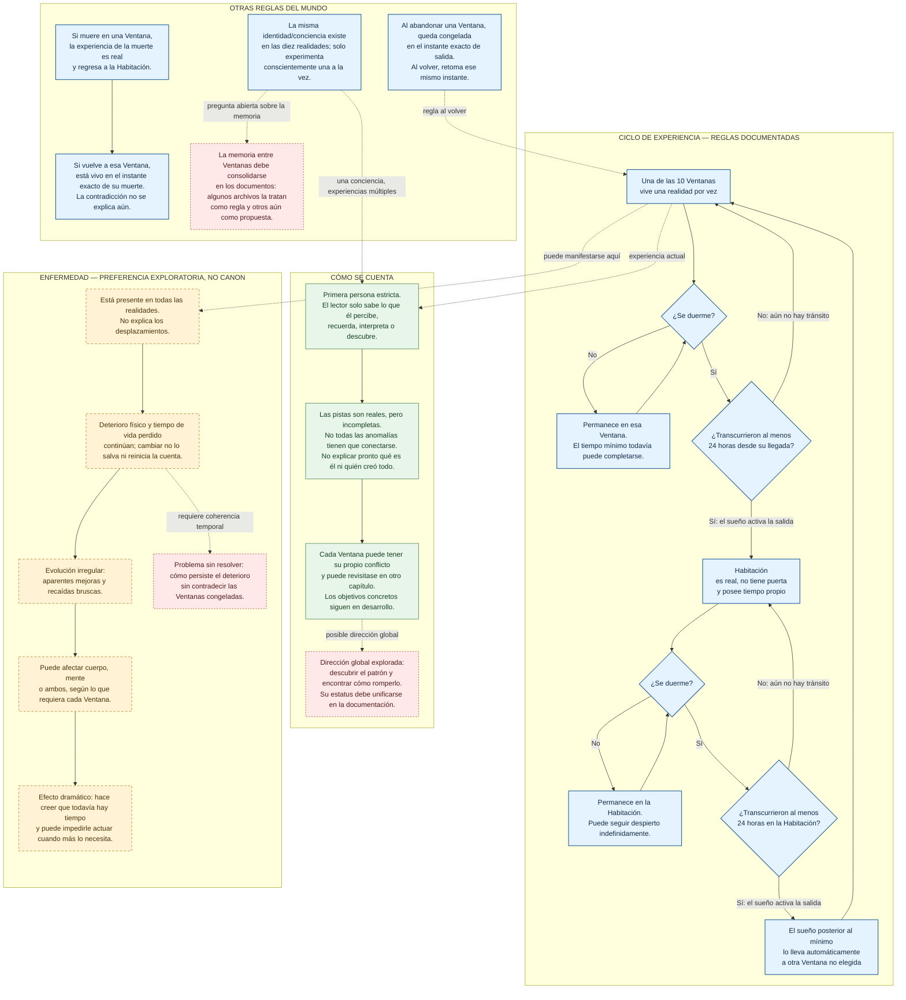

# WNL — Mapa general de funcionamiento de la novela
**Fecha:** 2026-10-12  
**Proyecto:** WATH NEVER LEFT  
**Estado:** mapa de trabajo; distingue canon documentado, preferencias exploratorias y dudas de continuidad. No modifica CANON ni el manuscrito.

> Principio rector: **Él vive las realidades. El lector descubre qué significan.**

## 1. Diagrama principal — mecánica, experiencia y misterio

## 2. Qué significa el ciclo, explicado sin tecnicismos

- Hay exactamente diez Ventanas y la Habitación. Todas son reales para el protagonista mientras las experimenta; no sabe de antemano cuál sería una realidad «verdadera».
- El sueño es el disparador, pero no basta por sí solo: deben haber transcurrido al menos 24 horas en la estancia correspondiente. Las 24 horas no significan que deba mantenerse despierto. Dormirse antes del mínimo no desplaza.
- Después de cumplirse el mínimo, el siguiente sueño lo devuelve de una Ventana a la Habitación o lo lleva de la Habitación a una nueva Ventana. No elige conscientemente el destino.
- La Habitación continúa en el tiempo; las Ventanas, según la regla temporal repetida en los archivos operativos, quedan congeladas cuando las abandona y se reanudan en el instante exacto cuando vuelve.
- La muerte en una Ventana lo devuelve a la Habitación. Si vuelve a esa Ventana, está vivo en el instante exacto en que recuerda haber muerto. No explicar por qué.
- La misma identidad/conciencia existe en las diez realidades, pero solo experimenta una conscientemente a la vez. La hipótesis de que la conciencia pueda existir separada del cuerpo y el cerebro funcionar como interfaz es una posibilidad filosófica de ficción, no una explicación científica demostrada.

## 3. Las diez Ventanas — inventario interno

Estos son los conceptos registrados en CANON/VENTANAS.md. **No deben asignarse automáticamente a los capítulos V3:** el repositorio advierte que las correspondencias de la reescritura todavía deben revisarse.

| Ventana | Concepto registrado | Estado anotado en el archivo |
|---|---|---|
| 1 | 1999 — Y2K; el desastre temido ocurre y la historia diverge | Pendiente de uso |
| 2 | 2012 — CERN/LHC; experimentos vinculados a una posible catástrofe global | Usada en el manuscrito anterior, capítulo 2 |
| 3 | 2014 — Vida cotidiana; vida aparentemente normal | Asociada al prólogo V2; revisar para V3 |
| 4 | 2026 — Cortexia | Pendiente de uso/adaptación |
| 5 | 2056 — Las Siete Arquitecturas autónomas | Desarrollada en capítulos 7–8 del manuscrito anterior |
| 6 | Bajo la Ciudad — La Puerta Inexplicable | Usada en el capítulo 1 del manuscrito anterior |
| 7 | La Casa que Recuerda — familia, sótano, puerta y llave | Usada y revisitata en el manuscrito anterior |
| 8 | La Ciudad que Despierta — ciudad vacía pero funcional | Asociada al capítulo 4 del manuscrito anterior |
| 9 | El Mundo Perfecto — realidad en la que no desea marcharse | Pendiente de uso |
| 10 | Copia Exacta — realidad idéntica al mundo externo | Pendiente de uso |

El orden en que aparecen las Ventanas no indica su orden cronológico ni su importancia. Una misma Ventana puede reaparecer en varios capítulos.

## 4. Enfermedad — todo lo elegido hasta ahora, todavía no canon

- La misma enfermedad está presente en todas las realidades; cambiar no lo salva, no reinicia el deterioro ni devuelve el tiempo de vida perdido.
- Su manifestación será irregular: puede mejorar aparentemente y empeorar bruscamente.
- Puede afectar tanto al cuerpo como a la mente; qué manifestación usar dependerá de la Ventana y de su situación narrativa. Todavía no se han asignado síntomas concretos a Ventanas específicas.
- El efecto emocional buscado combina dos cosas: le hace creer que aún tiene tiempo cuando casi no le queda y puede quitarle la capacidad de actuar cuando más lo necesita.
- La enfermedad no explica los desplazamientos ni debe revelar prematuramente la arquitectura de la novela.
- Los síntomas pueden fluctuar, pero la preferencia es que el deterioro y el tiempo perdido no retrocedan.
- No se han elegido nombre, diagnóstico, síntomas fijos, desencadenantes ni mecanismo médico.

### Nudo crucial aún no resuelto

Si una Ventana queda congelada al abandonarla, el cuerpo que deja allí no puede seguir deteriorándose durante su ausencia bajo esa misma regla. Aún falta decidir cómo la progresión de la enfermedad acompaña al protagonista y aparece en distintas realidades sin romper el congelamiento ni convertirlo en una excepción arbitraria.

## 5. Dirección narrativa y prólogo

- Narración estrictamente en primera persona: nada de información que el protagonista no pueda percibir, recordar, interpretar o descubrir.
- Principio guía: él vive las realidades; el lector descubre qué significan. Las pistas pueden ser ciertas sin que su significado se explique de inmediato.
- Proteger los misterios centrales: qué es realmente el protagonista, quién o qué creó la Habitación, qué significa la anomalía de la H y cuál es la arquitectura última del universo.
- Las conexiones entre Ventanas deben crecer solo cuando la historia lo necesite; no hacer que cada detalle extraño forme parte de un único rompecabezas.
- Preferencias de apertura: empezar dentro de una sola vida/realidad, sin abrir con la Habitación ni explicar otras realidades; evitar fechas y años al comienzo; no usar la desaparición pública de un avión ni «el mundo lo busca» como motor. Se busca un gancho cinematográfico y misterio, no una explicación temprana.
- La Habitación no tiene puerta y no debe aparecer al comienzo del prólogo según la dirección editorial expresada por el autor.

## 6. Estado real de la reescritura V3

- Hay borradores activos para prólogo y capítulos 1–4.
- El capítulo 4 V3 ocurre a bordo del velero Nereida: el protagonista está herido, no recuerda cómo llegó ni cómo se lesionó, el motor no arranca, la radio solo emite estática y los ruidos reciben explicaciones físicas dentro del propio capítulo.
- El capítulo 5 V3 no tiene una narración activa aprobada: la versión anterior fue descartada por el autor y debe replantearse desde cero.
- No hay conexiones confirmadas entre el velero, el prólogo y los capítulos 1–3.
- La asignación de las Ventanas a los capítulos V3 sigue pendiente de una revisión explícita.

## 7. Hipótesis relacionadas, pero aún no canonizadas

- La conciencia podría existir de algún modo independiente del cuerpo y el cerebro actuar como receptor/interfaz. Es una premisa de ficción que se explora, no un hecho científico demostrado.
- El protagonista podría conservar recuerdos y aprendizajes de sus experiencias entre realidades. El autor ha preferido explorar esa posibilidad, pero los archivos del repositorio no la clasifican de manera uniforme.
- La Habitación podría servir como espacio para anotar, comparar recuerdos, estudiar pistas y elaborar hipótesis. Su función como «centro de investigación» no está etiquetada de forma uniforme en todos los archivos.
- Cada Ventana puede tener un conflicto local y coexistir con una dirección global de comprender el patrón y romperlo; la definición de objetivos concretos todavía está en desarrollo.
- El sueño real compartido por el autor —desastre accidental en unas escaleras, soledad ante una responsabilidad imposible, culpa, persecución y terror— está disponible como inspiración emocional, no como trama obligatoria ni canon.

## 8. Inconsistencias documentales que el mapa NO resuelve por su cuenta

1. **Tiempo de las Ventanas:** los apartados específicos de congelamiento en BIBLIA_MAESTRA.md, además de VENTANAS.md y REGLAS_NARRATIVAS.md, establecen que la Ventana queda congelada y se retoma en el instante exacto. Sin embargo, una sección posterior de BIBLIA_MAESTRA.md dice que el tiempo continúa avanzando durante la ausencia. Este mapa utiliza la regla específica de congelamiento, pero señala la frase contradictoria para futura limpieza documental.
2. **Memoria entre realidades:** REGLAS_NARRATIVAS.md y VENTANAS.md la presentan como regla operativa, pero BIBLIA_MAESTRA.md, en su apartado de ideas recientes, aún la clasifica como posibilidad por explorar. La preferencia del autor es explorarla, pero el estado documental debe consolidarse.
3. **Habitación como centro de investigación y objetivo global:** algunas reglas operativas hablan de comparar pistas e intentar romper el patrón, mientras BIBLIA_MAESTRA.md todavía agrupa parte de esa dirección bajo ideas recientes en exploración. No elegir aquí qué archivo debe cambiar: requiere una decisión editorial explícita.
4. **Enfermedad y congelamiento:** la enfermedad está en IDEAS y no es canon. Su progresión entre Ventanas debe diseñarse sin quebrar la regla del tiempo congelado.

## 9. Leyenda de estado

- **Canon documentado:** regla escrita en los archivos operativos vigentes, salvo las inconsistencias señaladas.
- **Preferencia exploratoria:** dirección escogida por el autor para investigar, pero que no debe aplicarse como regla fija a la trama.
- **Pendiente:** pregunta, mecanismo o asignación que todavía no ha sido decidido.
- **Material histórico:** capítulos o mapas anteriores que ayudan a entender el proyecto, pero no deben imponerse automáticamente sobre la reescritura V3.

**Este archivo es un mapa de trabajo, no un reemplazo de la Biblia Maestra. No modifica CANON ni el manuscrito.**
